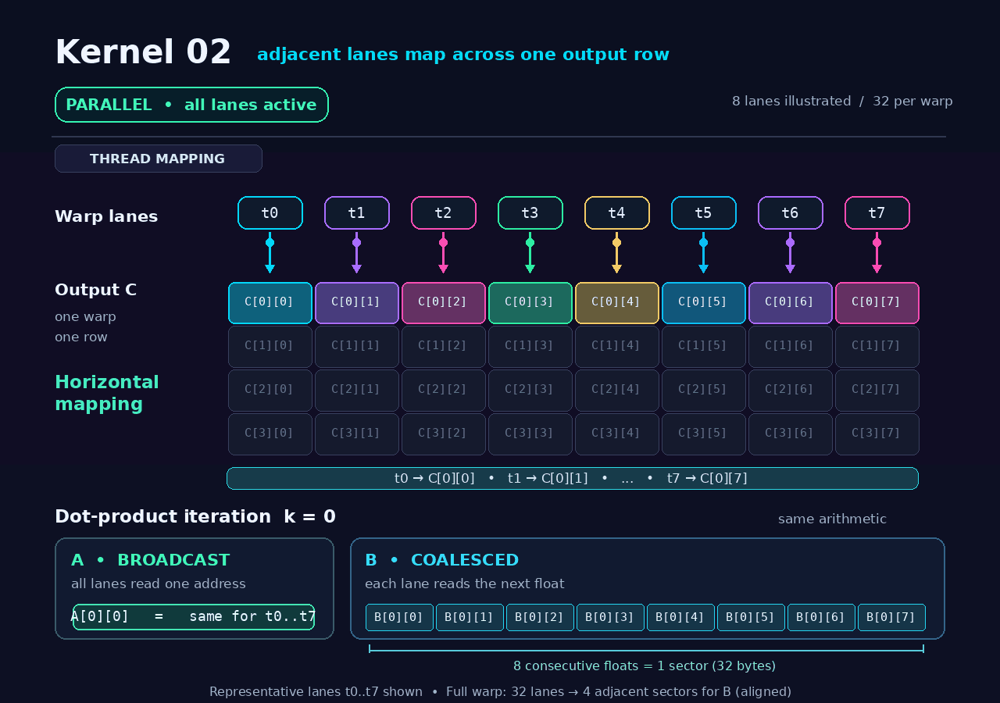

# Kernel 02 — Global Memory Coalescing

This kernel implements global-memory coalescing(sequential memory accesses by threads that are part of the same warp can be grouped and executed as one. This is referred to as global memory coalescing) by changing how threads access matrices `A` and `B`.

Instead of adjacent threads computing **vertically** along a column of `C`, they now compute **horizontally** along a row.

## 1. Previous Access Pattern — Kernel 01

Adjacent warp lanes compute different rows of the same output column.

```text
         Matrix C
       Col 0  1  2  ...
Row 0   T0
Row 1   T1
Row 2   T2
Row 3   T3
 ...    ...
Row 31  T31
```

At a fixed iteration `k` of the dot-product loop:

| Lane | Output | Loads from A | Loads from B |
|---|---|---|---|
| T0 | C[0][0] | A[0][k] | B[k][0] |
| T1 | C[1][0] | A[1][k] | B[k][0] |
| T2 | C[2][0] | A[2][k] | B[k][0] |
| ... | ... | ... | ... |
| T31 | C[31][0] | A[31][k] | B[k][0] |

**Memory behavior:**

- **A:** Different rows → Strided addresses across lanes → Poor coalescing.
- **B:** Same address across lanes → Broadcast-friendly.

## 2. New Access Pattern — Kernel 02

Adjacent warp lanes now compute neighboring columns of the same output row.

```text
              Matrix C
       Col 0   1   2   3  ...  31
Row 0      T0  T1  T2  T3 ... T31
Row 1
Row 2
 ...
```

At a fixed iteration `k`:

| Lane | Output | Loads from A | Loads from B |
|---|---|---|---|
| T0 | C[0][0] | A[0][k] | B[k][0] |
| T1 | C[0][1] | A[0][k] | B[k][1] |
| T2 | C[0][2] | A[0][k] | B[k][2] |
| ... | ... | ... | ... |
| T31 | C[0][31] | A[0][k] | B[k][31] |

**Memory behavior:**

- **A:** All lanes access the same element → Broadcast-friendly.
- **B:** Adjacent lanes access consecutive elements → Coalesced.

## 3. What Changed?

For a full warp of 32 threads loading FP32 values:

| Memory Access | Kernel 01 | Kernel 02 |
|---|---|---|
| Matrix A | Strided (~32 sectors) | Broadcast (1 sector) |
| Matrix B | Broadcast (1 sector) | Coalesced (4 sectors) |
| **Total sectors** | **~33** | **~5** |

*Illustrative sector counts for aligned accesses, not measured profiler results.*

**Key idea:** We haven't changed the GEMM arithmetic. We've changed which output element each thread computes, allowing the memory hardware to service warp-level loads using fewer sectors.

