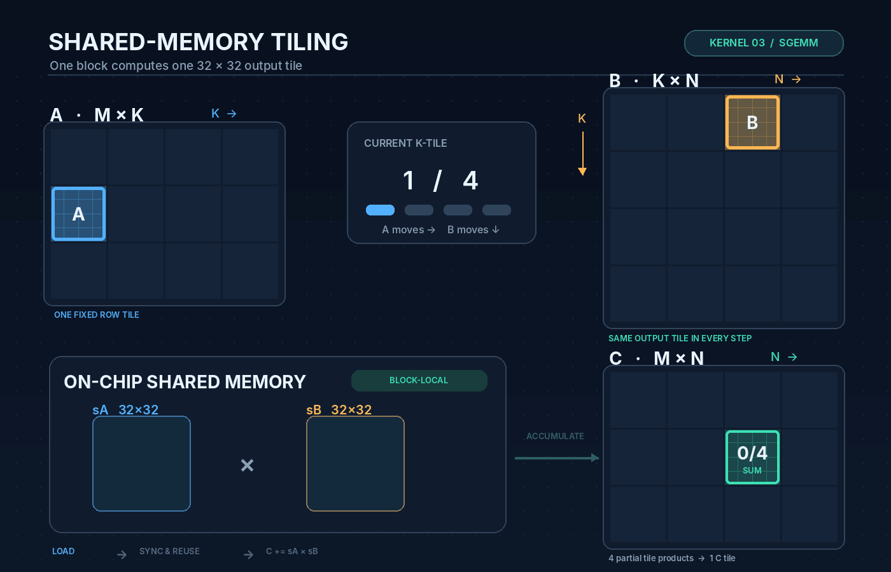

# Kernel 03 — Shared Memory Tiling

In Kernel 02, memory coalescing improved the efficiency of global-memory loads. However, threads still repeatedly issued global-memory load instructions, even when the requested data was cached in L1.

**What if we could load data once and reuse it across multiple threads?**

This is where **shared memory (SMEM)** comes in.

Shared memory is a small, fast, on-chip memory resource allocated to thread blocks on an SM. Threads within the same block can cooperatively load data into shared memory and reuse it during computation.

## How Shared Memory Tiling Works

Instead of repeatedly accessing global memory, we divide the matrices into **32 × 32 tiles**.

For each thread block:

1. Cooperatively load a `32 × 32` tile from **A** and **B** into shared memory.
2. Reuse those tiles to compute partial sums for a `32 × 32` tile of **C**.
3. Move the A tile right and the B tile down along the K dimension.
4. Repeat until the output tile is fully computed.

Note : Still each thread is still responsible for computing **one element of C** only.

## Visualization — 32 × 32 Tiled GEMM



**Color guide:**

- 🔵 **Blue — Matrix A:** Tiles move horizontally across columns.
- 🟠 **Orange — Matrix B:** Tiles move vertically down rows.
- 🟢 **Green — Matrix C:** A fixed output tile accumulates partial results.

At every iteration, a new pair of A and B tiles is loaded into shared memory, multiplied, and accumulated into the same C tile.

The animation illustrates four iterations; the actual number depends on the matrix's K dimension.

## Why This Could Be Faster

```text
Kernel 02:
Repeated global loads → Compute

Kernel 03:
Global loads → Shared Memory → Reuse → Compute
```

**Goal:** Reduce redundant global-memory load instructions through cooperative loading and data reuse, potentially reducing LG Throttle and improving throughput.

We'll verify this hypothesis through benchmarking and Nsight Compute profiling.