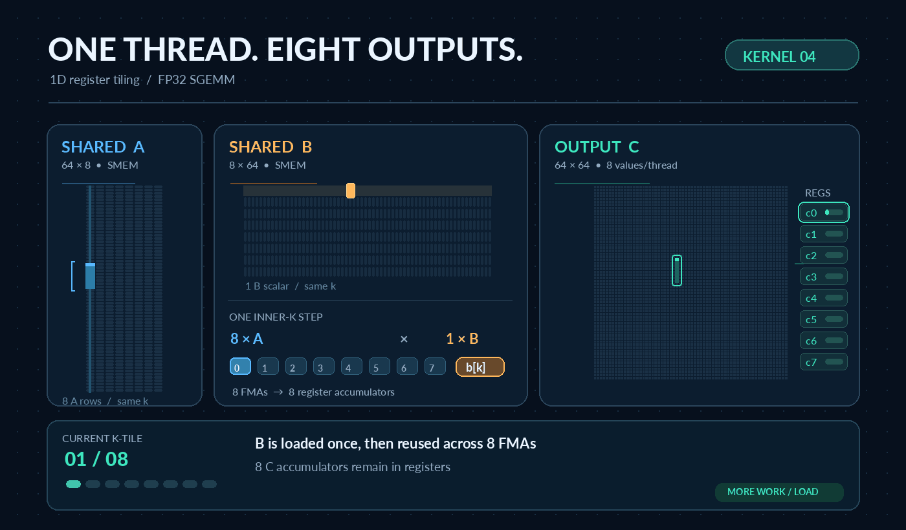

# Kernel 04 - 1D Block Tiling (FP32 SGEMM)

Our primary challenge after Kernel 03 was to **reduce MIO Throttle**, the dominant reason warps could not issue instructions. Although shared-memory tiling reduced repeated global-memory access, each thread still computed just one element of C and repeatedly loaded operands from shared memory. Those frequent load instructions placed pressure on the MIO instruction queue.

**What if each thread computed multiple elements of C and reused an operand across several FMAs?** We could do more arithmetic per shared-memory load instruction, reduce pressure on the MIO pipeline, and potentially improve throughput without increasing DRAM traffic.

## 1. From One Output per Thread to Eight

Kernel 03 assigned one output element to each thread. At a conceptual K step, one thread used an A value and a B value to perform one FMA:

```cpp
acc += a * b;  // One C element per thread
```

Kernel 04 instead assigns **eight vertically adjacent C elements** to a thread. For the same K step, those eight outputs have different A values but share the **same B value**:

```cpp
const float b = Bs[dotIdx * BN + threadCol];
for (int r = 0; r < 8; ++r) {
    const float a = As[(threadRow * 8 + r) * BK + dotIdx];
    acc[r] = fmaf(a, b, acc[r]);
}
```

The thread keeps eight partial sums in registers. Rather than requesting a B value for each FMA, it loads B once and reuses it across eight FMAs.

| Conceptual work at one K step | Kernel 03 | Kernel 04 |
|---|---:|---:|
| Outputs computed by one thread | 1 | 8 |
| A values read from SMEM | 1 | 8 |
| B values read from SMEM | 1 | 1 |
| FMAs performed | 1 | 8 |
| Scalar SMEM reads per FMA | 2.0 | 1.125 |

These are algorithmic counts, not literal SASS instruction counts; compiler vectorization and scheduling affect the instructions actually executed. This increases **arithmetic work per shared-memory operand read**. It does not automatically improve arithmetic intensity measured against DRAM bytes.

## 2. Kernel Configuration

| Parameter | Kernel 04 |
|---|---|
| Output tile | `BM=64`, `BN=64` |
| Reduction tile | `BK=8` |
| Outputs per thread | `TM=8` (one column, eight rows) |
| Threads per block | `512` (16 warps) |
| A shared-memory tile | `64 x 8` floats |
| B shared-memory tile | `8 x 64` floats |
| Total static shared memory | `4,096` bytes/block |
| Accumulators | Eight FP32 values per thread |
| Target GPU | NVIDIA GTX 1650, Turing (`sm_75`) |

One 512-thread block computes a `64 x 64` output tile. During each `BK=8` iteration, the block cooperatively loads 512 elements of A and 512 elements of B into shared memory: **one global-memory A load and one B load per thread per K-tile**. After a barrier, each thread reuses the shared tiles to accumulate eight outputs. A second barrier protects the shared tiles before the next K iteration overwrites them.

## 3. Optimization Hypothesis

```text
Kernel 03: 1 output/thread
    Frequent A and B shared-memory loads
                 |
       High MIO instruction demand
                 |
            Warp stalls

Kernel 04: 8 outputs/thread
    Load one B value -> reuse in 8 FMAs
                 |
       Fewer shared loads per FMA
                 |
       Less MIO instruction pressure
                 |
        Higher useful FP32 throughput


```

The tradeoff is **more registers per thread**, which can reduce occupancy. We evaluate the design with both CUDA-event benchmarks and Nsight Compute rather than assuming either higher occupancy or fewer loads must always win.

## 4. What Happened?

| Matrix | Kernel 03 | Kernel 04 | Speedup |
|---|---:|---:|---:|
| `512 x 512` | 280.63 GFLOP/s | **526.39 GFLOP/s** | **1.88x** |
| `1024 x 1024` | 314.40 GFLOP/s | **643.30 GFLOP/s** | **2.05x** |
| `2048 x 2048` | 362.40 GFLOP/s | **676.37 GFLOP/s** | **1.87x** |
| `4096 x 4096` | 364.58 GFLOP/s | **878.56 GFLOP/s** | **2.41x** |

At `512 x 512`, dynamically executed shared-memory **load instructions fell by 70.0%** compared with Kernel 03. Normalized MIO Throttle decreased from **23.60 to 4.62**, while benchmark throughput increased by **1.88x**. At `4096 x 4096`, MIO Throttle decreased from **23.80 to 4.03** and throughput improved by **2.41x**.

Kernel 04 uses **66 registers/thread** versus Kernel 03's 44, reducing achieved occupancy from approximately 100% to **50%**. No register spilling was observed. In this experiment, reducing instruction pressure mattered more than preserving maximum occupancy.

The observed improvement also reflects changes to the output tile, K tile, and block size; register reuse is a strongly supported explanation, not an isolated causal measurement.

## 5. Reproduce

From `experiments/04_1d_block_tiling` in the **x64 Native Tools Command Prompt for VS 2022**:

```cmd
nvcc -O3 -std=c++17 -arch=sm_75 -lineinfo block1d_gemm.cu -o block1d_gemm.exe
block1d_gemm.exe 512 5 1
block1d_gemm.exe 1024 5 1
block1d_gemm.exe 2048 5 0
block1d_gemm.exe 4096 5 0
```

Arguments: `matrix_size timed_runs verify(0/1)`. Timing uses CUDA events and the median of five timed runs. Verification passed at sizes 512 and 1024; larger sizes were benchmarked with verification disabled.

## 6. Documentation and Next Step

- [Performance results across Kernels 01-04](results.md)
- [Nsight Compute investigation and Kernel 05 hypothesis](profiling.md)
- [Raw profiler measurements and commands](https://github.com/sreemourya7/cuda-nsight-compute-profiling/blob/main/kernels/04_1d_tiling_cuda/README.md)

Kernel 04 has relieved much of the previous MIO pressure, but **MIO Throttle and Long Scoreboard remain major stalls**. Kernel 05 will investigate **2D register tiling**, where each thread computes a small rectangular output patch and can reuse *both* A and B values, not only B.

*Visualization/GIF: to be added later.*
